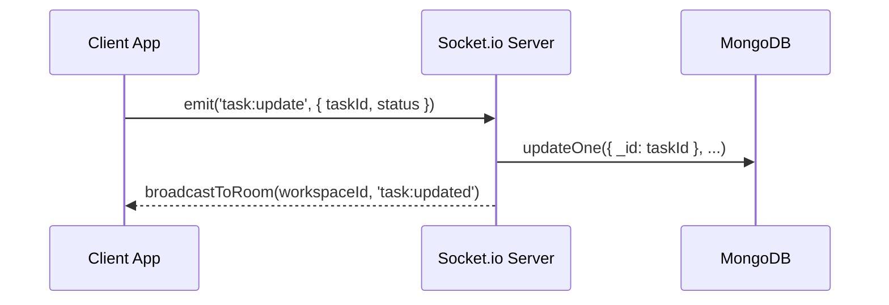

# System Architecture

## Client Architecture
The frontend is a single-page application built on **React 19** with client-side routing.
- **State Management**: Zustand for global UI and active workspace session state; TanStack React Query for asynchronous server-cache synchronization.
- **Component Primitives**: Radix UI headless primitives styled with Tailwind CSS utility classes.
- **Interactive Canvases**: `@dnd-kit` and `@hello-pangea/dnd` for smooth multi-list board sorting; `reactflow` for flowchart planning.

## Backend Architecture
The backend is structured into modular layers adhering to separation of concerns:
1. **Controllers**: Request validation, parameter parsing, and HTTP status orchestration.
2. **Services**: Business logic, transactional workflows, and cache operations.
3. **Data Access (Models)**: Mongoose schemas enforcing relational data integrity in MongoDB.
4. **WebSocket Server**: Socket.io room multiplexing keyed by `workspaceId` and `boardId`.

## Event Dispatch Lifecycle

